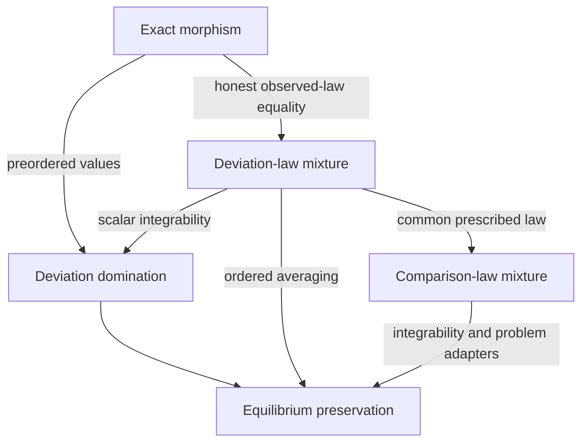

# Equilibrium morphisms and simulations

## Status and proposed contribution

Draft for a design issue, 9 November 2026. The base is MathEconLib
`f379e22088caa905e95701e1f820696a4c40b01c`. Names and signatures below are
proposals. This document adds no public Lean declarations and changes no
existing equilibrium predicate. Implementation would follow agreement on the
design, as required by [CONTRIBUTING.md](../CONTRIBUTING.md#design-first-for-core-layers).

The proposed contribution is a small family of transport contracts around the
existing `EquilibriumProblem`:

1. Retain exact `GameMorphism` and `GameComorphism` and explain their directions.
2. Add preservation by deviation domination, with identity and composition.
3. Establish preservation by averaging admissible source deviations, including
   vector payoffs. Derive scalar domination when expectations are finite.
4. Add utility-independent certificates for mixtures of outcome laws when the
   clients justify retaining the mixture witnesses.
5. State precisely when these contracts give reflection or an equivalence.

Utility simulation should specialize this shared transport theory to utility
evaluations. It should not introduce a second game or equilibrium foundation.
The full collection is a design map; the implementation sequence in section 8
does not introduce every proposed record at once.

## 1. Existing owners and scope

The following definitions remain the owners of their concepts:

| Concept | Existing owner |
| --- | --- |
| States, deviations, values, candidate validity | [`EquilibriumProblem`](../MathEconLib/GameTheory/Equilibrium/Problem.lean) |
| Exact preservation and reflection | `GameMorphism`, `GameComorphism`, in the same module |
| Product actions and unilateral changes | [`StrategicGame`](../MathEconLib/GameTheory/Strategic/Basic.lean) |
| Outcomes and their utility evaluation | [`OutcomeGame`, `PayoffStructure`](../MathEconLib/GameTheory/Strategic/Outcome.lean) |
| Independent mixing and its integrability guards | [`mixedNashProblem`](../MathEconLib/GameTheory/Strategic/Mixed.lean) |
| Finite probability | [`FinDist`](../MathEconLib/Probability/FinDist/Basic.lean), over Mathlib's simplex |
| General probability laws | Mathlib `ProbabilityMeasure` and the existing [measure lemmas](../MathEconLib/ForMathlib/ProbabilityMeasure.lean) |

Candidate validity constrains the incumbent. An admissible deviation to an
invalid target still counts. Every full-equilibrium transport theorem must
therefore include the appropriate preservation or reflection of validity;
deviation-optimality transport is a separate theorem.

Two active discussions constrain the design:

- [PR #281](https://github.com/matheconlib/matheconlib/pull/281), open when
  checked on 9 November, introduces `IsOptimalWith`, `IsDeviationOptimalWith`,
  and `IsEquilibriumWith`, together with exact-map transport. Its comparison
  slice already has a design history. This proposal should coordinate with it.
- [Issue #242](https://github.com/matheconlib/matheconlib/issues/242) leaves the
  intended finite-expectation and deviation-coverage contracts under review.
  This proposal uses the predicates on its base revision as written. It does
  not decide that repair, add infinite expectations, or broaden admitted
  deviations silently.

The design follows [DESIGN.md](../DESIGN.md): shared primitives, explicit
representation changes, assumptions on the results that need them, and
representative clients. General-purpose integration lemmas belong with the
relevant mathematics; economic transport contracts belong with game theory.

## 2. Contract map

Write `P` for a source problem on states `S` and deviators `I`, and `Q` for a
target problem on `T` and `J`. Both have values in `V`. The state map is
`f : S → T`. Preservation uses a deviator map `g : J → I`; reflection uses a
map in the other direction.

| Contract | Correspondence required | Conclusion | Status |
| --- | --- | --- | --- |
| `GameMorphism P Q` | Every target deviation from `f s` lifts to a source deviation whose image is exactly its target; values agree | Source equilibrium implies target equilibrium | Existing |
| `GameComorphism P Q` | Source deviations map to target deviations; values agree | Target equilibrium at `f s` implies source equilibrium | Existing |
| `GameSimulation P Q` | Every target deviation is value-bounded by a source deviation; incumbent values weakly increase | Preservation | Proposed ordered-value contract |
| Utility simulation | A `GameSimulation` for specified utility evaluations | Preservation for those utilities | Specialization, not another record by default |
| Deviation-law mixture | Each target deviation's observed law is a mixture of admissible source deviation laws; honest observed laws agree | Averaging transport for compatible evaluations | Proposed certificate, finite first |
| Comparison-law mixture | Both laws of each target incentive comparison are mixtures of source comparison laws, with the same weights | Preservation of the corresponding integral inequalities | Lower-level extension, consumer-gated |
| Equilibrium equivalence | Preservation and reflection at the same translated candidates | An iff at those candidates | Derived statement; no new universal equivalence record |

These contracts do not form an unconditional linear hierarchy.



The exact-map-to-mixture arrow supplies pointwise, one-point mixtures. It does
not supply a measurable family of selected lifts. The later kernel version
requires that additional condition.

## 3. Exact maps, reflection, and equivalence

`GameMorphism` already requires

\[
D_Q(j,f(s),t)\Longrightarrow
  \exists s'.\ D_P(g(j),s,s')\ \land\ f(s')=t,
\qquad v_Q(j,f(s))=v_P(g(j),s).
\]

Its `valid_preserves` field gives full-equilibrium preservation. The exact
value equalities permit transport with only `[LE V]`; transitivity is not
needed.

`GameComorphism` instead maps each source deviation into a target deviation
and reflects validity. Its `pullback` theorem reflects equilibrium from an
image state. Both contracts already have identity and composition.

For the same `f`, a morphism and a comorphism yield an equilibrium iff at
`s` and `f s`. Their deviator maps need not be inverse for this logical result:
each existing theorem supplies one direction. To claim correspondence of the
entire equilibrium sets, additionally require every target equilibrium to
have a suitable preimage; surjectivity of `f` is one sufficient condition.

Playerwise action compilation commutes with unilateral updates. Together with
honest payoff equality, it therefore supplies the deviation and value parts
of a comorphism for the appropriate strategic problems. Validity reflection
and any integrability condition in the actual deviation relations remain
separate obligations. The existing `comapActionsComorphism` is the basic
example.

An exact morphism alone says nothing about outcome-law equality. If law maps
`L_P : S → ProbabilityMeasure O` and `L_Q : T → ProbabilityMeasure O` also
satisfy `L_Q (f s) = L_P s`, an exact lift `s'` represents the target deviated
law by the one-point source mixture at `s'`. That is the precise bridge to
the law-level contract below.

## 4. Preservation by deviation domination

A target deviation can be harmless even when it is not the image of any
source state. It suffices that an admissible source deviation has at least
its value, and that the translated incumbent has at least the source value.

The following is a proposed signature, with carriers explicit. Names are
provisional. The code is a design sketch, not a declaration added by this
branch.

```lean
structure GameSimulation {S I T J V : Type*} [Preorder V]
    (P : EquilibriumProblem S I V) (Q : EquilibriumProblem T J V) where
  toFun : S → T
  deviatorMap : J → I
  value_le : ∀ j s, P.value (deviatorMap j) s ≤ Q.value j (toFun s)
  deviation_dominated : ∀ j s t, Q.deviation j (toFun s) t →
    ∃ s', P.deviation (deviatorMap j) s s' ∧
      Q.value j t ≤ P.value (deviatorMap j) s'
  valid_preserves : ∀ s, P.valid s → Q.valid (toFun s)
```

The selected maps are data, so a bundle containing them belongs in `Type`.
The deviation witnesses may remain existential: consumers need their
existence, not a chosen simulation algorithm. No typeclass instance should
search for these certificates.

The preservation argument is

\[
v_Q(j,t)\le v_P(g(j),s')\le v_P(g(j),s)\le v_Q(j,f(s)).
\]

The middle step uses source deviation optimality. Transitivity explains the
`Preorder` assumption. Equality of incumbent values is useful for reflection
but unnecessary for this preservation theorem.

The proposed interface consists of:

- `transport_isDeviationOptimal` and `transport`;
- `id`, `comp`, and extensionality by equality of the selected maps;
- evaluation, identity, associativity, and conversion/composition compatibility;
- `GameMorphism.toSimulation`, using value equality and exact deviation lifting;
- an unbundled transport theorem accepting fixed maps and the same hypotheses.

For `f : P → Q` and `h : Q → R`, compose the state maps as `h ∘ f` and the
deviator maps in the reverse order. For a target deviation, first use `h`'s
dominating intermediate deviation and then `f`'s dominating source deviation.
The inequalities and validity implications compose. This also gives mixed
exact/simulation composition by conversion, without another pair of records.

The unbundled theorem should be available even if review concludes that the
bundle has too few independent consumers. Retain the public bundle only once
the clients below demonstrate reuse or useful composition. No general
category instance is proposed.

A simulation gives one direction. An iff requires an independently established
reflection contract, for example a compatible `GameComorphism` with the same
state map. Scalar expected utilities are an application of this theory; they
do not require a duplicate `UtilitySimulation` record. This does not reproduce
all of GameTheory's coalition or extended-expectation certificate.

## 5. Averaging and law-level certificates

### 5.1 Ordered-value averaging

Fix `s`, a target deviator `j`, and an admitted target deviation to `t`.
Suppose there is a probability measure `ν` over source states such that

\[
D_P(g(j),s,s')\quad\text{for }\nu\text{-almost every }s',
\qquad
v_Q(j,t)=\int v_P(g(j),s')\,d\nu(s').
\]

Assume the source-value integrand is Bochner integrable, incumbent comparison
`v_P (g j) s ≤ v_Q j (f s)`, and preservation of candidate validity. Then source
equilibrium implies target equilibrium. A target deviation may have its own
representing measure; no measurable selection across all deviations is
needed for this one-step theorem.

For vector-valued payoffs use a complete real normed space with compatible
partial order and closed positive cone. In Mathlib, the intended monotonicity
step uses `integral_mono_ae` under `PartialOrder`, `IsOrderedAddMonoid`,
`IsOrderedModule ℝ`, and `ClosedIciTopology`, in addition to the normed-space
and integration hypotheses. Probability normalization turns the integral of
the constant incumbent value into that value.

An arbitrary order on a Banach space is insufficient. A raw totalized integral
without the integrability hypothesis is also insufficient.

### 5.2 Scalar mean bound

For real-valued, integrable source values, a representing measure concentrated
on admissible deviations supplies one admissible state with value at least
the integral. This constructs the domination field of `GameSimulation`.
Mathlib's `exists_notMem_null_integral_le` supplies the result while avoiding
the null set of inadmissible source states.

This chooses a value at least the mean; it need not equal the mean. The
witness can depend on the chosen utility. Infinite expected values are outside
this construction.

The vector analogue fails: neither `(1, 0)` nor `(0, 1)` componentwise dominates
their mean `(1/2, 1/2)`. This refutes a general constructor from mixtures to
single dominating witnesses. It does not refute ordered averaging, and a
particular equilibrium may supply some other dominating admissible state.

### 5.3 Utility-independent deviation-law mixtures

Now keep separate law maps `L_P` and `L_Q` on a common observation space `O`.
Reuse existing `OutcomeGame` and `ProbabilityMeasure` constructions when
producing these maps; they are not a new game record. If the games have
different outcome carriers, map both to `O` and state preservation there.

For fixed state/deviator maps and deviation relations, the law contract is:

1. Honest play: `L_Q (f s) = L_P s`.
2. For each target deviation, a probability mixture of admissible source
   deviations reproduces `L_Q t` exactly.

For the first version use a finite mixture: a finite index carrier `K`, existing
`FinDist K` weights `w`, and source states `a k` with

\[
w_k>0\Longrightarrow D_P(g(j),s,a_k),
\qquad L_Q(t)=\sum_{k\in K}w_k L_P(a_k).
\]

Only the mixture index must be finite. This does not require finite state or
outcome spaces. Place any `Fintype` assumption on the mixture operation or
certificate, rather than on a bare game. Reuse existing finite probability
operations and their measure bridges.

Evaluation by an integrable utility on `O` turns this law equality into the
ordered-value representation in 5.1. The adapter must prove that these
integrals are the values of the actual `EquilibriumProblem`s. Honest-law
equality alone does not establish candidate validity or deviation coverage.
When deviators are reindexed by `g`, their evaluations must also agree under
that reindexing; for utility functions, require
`u_Q j o = u_P (g j) o` on the relevant observed laws.

A proposed name is `DeviationMixture`, as data for fixed maps and law/deviation
arguments. A predicate such as `HasDeviationMixtures` should state existence
if a consumer never inspects the weights. Avoid adding both public names until
their respective roles are demonstrated. Data needed for composition belongs
in `Type`; existence and validity conditions belong in `Prop`.

Finite mixtures compose by multiplying the outer and inner weights and
flattening the finite family. Check that every intermediate deviation used
by the outer certificate is covered by the inner certificate. A restricted
certificate must expose this support-compatibility premise; a total one can
derive it. The honest laws compose as well.

For arbitrary measures, composition needs a measurable family of inner
mixtures, law-kernel measurability, and the applicable join and integration
identities. Pointwise existential witnesses alone do not provide a measurable
kernel. That extension is separate from the finite first slice. Mixture
composition does not require reducing to a single scalar witness.

### 5.4 Comparison-law mixtures

A later lower-level certificate can mix pairs of laws. If source comparisons
are `(A_k, B_k)` and a target comparison is `(A, B)`, require

\[
A=\sum_k w_k A_k,\qquad B=\sum_k w_k B_k
\]

with the same weights. Inequalities between the source utility integrals then
imply the target inequality. In the general measure version retain the
integrability required for the tower identity; finite support and integrable
source laws give a simpler first statement.

A deviation-law mixture gives this certificate when every source prescribed
law is the fixed incumbent law, using honest-law equality. The reverse bridge
to equilibrium transport additionally needs adapters identifying both sides
with the problem's incumbent and legal deviations. A general pair mixture
does not itself contain a profile compiler or identify one source incumbent.

This can support Bayesian incentive comparisons with different conditioning
contexts, but that is an intended later application, not a theorem supplied
by this proposal. Introduce a public pair-certificate record only after such
a second consumer is specified. No completeness claim is made: mixtures of
law pairs are sufficient certificates, not all possible utility-independent
incentive implications.

## 6. Limits of the bridges

| Claimed implication | Conditions or obstruction |
| --- | --- |
| Exact morphism implies ordered simulation | Valid under `Preorder V`; use equality as the domination bound |
| Exact morphism implies a law mixture | Also require commuting observed laws; pointwise Dirac witnesses suffice for the finite version |
| Deviation-law mixture implies scalar simulation | Require integrable scalar evaluation, incumbent agreement, and validity preservation |
| Deviation-law mixture implies an exact morphism on profiles | Fails when an added randomized target action is outside the compiler image |
| Vector mixture implies a dominating source value | Fails for the two incomparable vectors in 5.2 |
| Averaging implies equilibrium preservation | Requires ordered integration, actual admitted-deviation coverage, incumbent comparison, and validity |
| Utility simulation implies law simulation | Fails: equal or bounded utilities need not determine outcome laws |
| Preservation implies reflection | Fails without a separate source-deviation correspondence and validity reflection |
| Mixtures of coalition deviations preserve strong Nash | Fails: the member blocking a deviation can vary across mixture components |

For the last obstruction, source gain vectors `(2, -1)` and `(-1, 2)` each
leave some coalition member worse off; their fair mixture gives both members
gain `1/2`. The two inequalities alone are not a whole-game counterexample.
A complete regression can use two players with actions `0, 1, 2`, payoff
`(2, -1)` at `(1, 1)`, `(-1, 2)` at `(2, 2)`, and `(0, 0)` elsewhere.
The incumbent `(0, 0)` is strong Nash, including all smaller coalitions.
Add an action `M` for each player. At `(M, M)` jointly randomize between the
two special source profiles; elsewhere interpret each `M` as `0`. Honest
compiled profiles are unchanged, but the joint deviation `(M, M)` improves
both expected payoffs.

To transport coalition equilibrium by a utility bound, require one legal joint
source replacement that bounds every member simultaneously. Selecting a
different scalar witness for each member is insufficient. Defer a coalition
certificate until a client fixes its comparison and deviation semantics.

## 7. Comparison and approximation extensions

The first ordered-value simulation does not assume every future comparison
is transitive. In particular, additive slack and existential coalition
comparisons generally are not preorders. The present core only requires `LE`,
so that fact alone is not a proof of unrepresentability. Coordinate the
explicit-comparison API in #281 rather than adding another preference field
or changing `EquilibriumProblem` here.

For scalar additive slack, the same domination chain preserves the same
`ε`: if the source deviation value is at most its incumbent plus `ε`, target
domination and incumbent comparison give the same target inequality. State
this through the agreed explicit-comparison specialization and its validity
guard. It is a proposed theorem, not an existing target ε-Nash API.

For arbitrary comparisons, ordered domination alone is insufficient. Require
the relevant compatibility of source and target comparisons with the bounds,
or retain exact-map transport. No general `transportWith` theorem follows just
from calling a relation a preference.

Approximate outcome-law matching is a separate extension. For utilities in
`[m, M]` and total variation normalized as the supremum over measurable events,
errors `δ₀` in the incumbent law and `δ₁` in the deviated law give additional
slack `(M - m) * (δ₀ + δ₁)`. Proving an adapter requires the actual distance
convention and boundedness hypotheses. Unbounded utilities and computational
indistinguishability require other contracts; an arbitrary test family does
not imply preservation of expected-utility or pseudo-Nash comparisons.

## 8. Clients and staged introduction

Choose the clients before settling the record layout, and compare an unbundled
theorem with the proposed bundles against the same models. Record assumptions,
proof reuse, dependence on implementation fields, imports, and elaboration
cost. Each positive client must apply the named public transport theorem.

| Client | Required application | Boundary checked |
| --- | --- | --- |
| One-player added coin action | Start with actions `L`, `R`, values `1`, `0`; add `M` with value `1/2`. Compile by inclusion and transport equilibrium at `L` by domination. Compose with a materially different coarsening or action translation. | `M` is an admitted target deviation outside the image, so the chosen inclusion cannot be an exact morphism. The source must have a legal dominating witness. |
| Pure-to-mixed Dirac embedding | Prove that pure Nash gives `IsMixedNash` at the Dirac profile, using the actual mixed problem and its integrable-deviation guard. Include a finite positive model. | Incumbent integrability, product/Dirac identities, and actual deviation scope are discharged; no raw-integral equilibrium is substituted. |
| Vector-payoff averaging | Apply the averaging result to a finite game with a genuine common maximal payoff, such as `(1,1)` above `(1,0)` and `(0,1)`. | Separately check failure of the general dominating-support-point lemma for the latter two vectors; do not claim that no other simulation exists in the positive model. |
| Existing finite Bayesian expansion | Recover an existing finite Bayesian-to-strategic equilibrium implication through the exact-to-simulation conversion. | This checks compatibility with the existing vocabulary; it does not alone justify the new abstraction. |
| Validity and guard controls | Reuse or extend the existing candidate-validity and integrability regressions. | Invalid images must block full transport. Invalid deviation targets must still count. Nonintegrability must not be evaluated as an economic zero. |

The one-player client tests a useful non-exact simulation. In that complete
two-action/three-action game, a stronger no-morphism result can be proved by
cardinality, but the essential contract test concerns the declared compiler.
The vector positive client and its negative support-point lemma answer
different questions and must remain distinct.

Suggested delivery order:

1. **Design agreement.** Decide the first clients, names, and bundled versus
   unbundled surface. Confirm coordination with #281 and #242. This document
   can form the body of the design issue.
2. **Ordered transport.** Add the unbundled domination theorem and, if justified
   by the clients, `GameSimulation`, its coherent composition API, and the
   exact-map conversion. Deliver the coin-action client and validity controls.
3. **Averaging.** Reuse Mathlib's integral monotonicity and mean-bound results.
   Add the pure-to-mixed client, vector positive control, and scalar/vector
   distinction. Avoid duplicating general integration mathematics.
4. **Finite law certificates.** Introduce retained mixture data once both a
   direct client and a composition client use it. Prove the evaluation adapter,
   finite composition, and conversion to scalar domination.
5. **Later consumers.** General measurable kernels, comparison-law mixtures,
   coalition bounds, and quantitative errors each need a stated consumer and
   their own guard/compatibility checks. They do not block the initial slice.

Proposed placement, subject to the agreed scope:

- ordered transport: `GameTheory/Equilibrium/Simulation.lean`;
- averaging adapter: `GameTheory/Equilibrium/Averaging.lean`, with general
  mathematical prerequisites kept independent of game theory;
- finite law certificates: `GameTheory/Equilibrium/Mixture.lean`;
- applications: `MathEconLibExamples/GameTheory/`;
- API and boundary regressions: `MathEconLibTest/GameTheory/`.

Before an implementation lands, regenerate the relevant imports and API pins,
run focused checks, the default build, and the repository's proof-integrity
checks. Exercise the intended umbrella import. Documentation and examples
must distinguish main declarations, proposed contracts, and checked clients.
This branch contains only this draft, so none of those future implementation
checks is claimed here.

Draft validation: relative file links and whitespace were checked. The
`GameSimulation` structure signature was elaborated in isolation against the
base revision's definitions with Lean 4.35. This is a signature check, not a
checked client or an implementation of the proposed theorem API.

## 9. Provenance and decisions to make

The existing MathEconLib definitions and their comments determine the target
contracts. The candidate-validity regressions in
[`CandidateValidity.lean`](../MathEconLibTest/GameTheory/CandidateValidity.lean),
the [action-map clients](../MathEconLibTest/GameTheory/StrategicTransport.lean),
and the [vector-payoff tests](../MathEconLibTest/GameTheory/VectorPayoffs.lean)
are starting points for validation.

Source developments in GameTheory at
`6f1af625b77215dd9e4454e6120275dbd8b61f51` provide proof ideas and boundary cases:

- [MixtureSimulation](https://github.com/elazarg/GameTheory/blob/6f1af625b77215dd9e4454e6120275dbd8b61f51/GameTheory/Core/MixtureSimulation.lean)
  and [composition](https://github.com/elazarg/GameTheory/blob/6f1af625b77215dd9e4454e6120275dbd8b61f51/GameTheory/Core/MixtureSimulationComposition.lean);
- [UtilitySimulation](https://github.com/elazarg/GameTheory/blob/6f1af625b77215dd9e4454e6120275dbd8b61f51/GameTheory/Core/UtilitySimulation.lean)
  and the [scalar bridge](https://github.com/elazarg/GameTheory/blob/6f1af625b77215dd9e4454e6120275dbd8b61f51/GameTheory/Core/MixtureUtilitySimulation.lean);
- [comparison-law simulations](https://github.com/elazarg/GameTheory/blob/6f1af625b77215dd9e4454e6120275dbd8b61f51/GameTheory/Analysis/IncentiveSimulation.lean).

Those statements are not cross-library equivalences. Their PMF,
extended-expectation, profile, and coalition choices must be translated to the
target contracts rather than imported as another foundation.

The design issue should settle:

1. Whether two concrete consumers justify the ordered simulation bundle now.
2. Whether weak incumbent improvement is the desired general contract, with
   equality supplied separately by reflection adapters.
3. Whether finite law certificates should expose chosen weights or only assert
   their existence for the first consumers.
4. Which pure-to-mixed statement matches the agreed expectation/deviation scope.
5. Which later client first needs measurable kernels or pairwise comparison
   mixtures, so their stronger conditions can be chosen from actual use.
