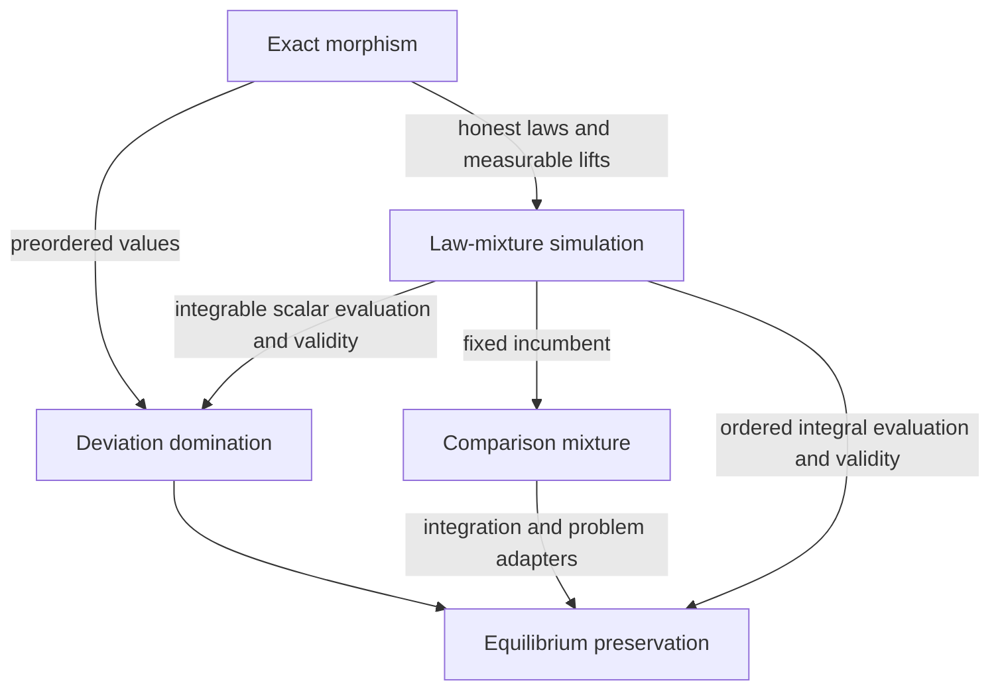

# Equilibrium morphisms and simulations

## Status

Implementation draft on `design/equilibrium-simulations`, based on MathEconLib
`f379e22088caa905e95701e1f820696a4c40b01c`. The branch extends the theory around
`EquilibriumProblem`; its fields and existing equilibrium predicates are unchanged.
The new API is proposed for review, not an adopted upstream design.

The implementation is available through
[`MathEconLib.GameTheory.Equilibrium`](../MathEconLib/GameTheory/Equilibrium.lean).
The exact Lean declarations are authoritative for binders and assumptions.

| Module | Content |
| --- | --- |
| [Simulation](../MathEconLib/GameTheory/Equilibrium/Simulation.lean) | Pointwise domination, `GameSimulation`, transport, composition, exact-map conversion, reflection, and additive slack |
| [Averaging](../MathEconLib/GameTheory/Equilibrium/Averaging.lean) | Ordered integral bounds and the scalar dominating-witness constructor |
| [Mixture](../MathEconLib/GameTheory/Equilibrium/Mixture.lean) | Utility-independent kernel simulation, composition, observations, evaluation, and exact-lift relationships |
| [ComparisonMixture](../MathEconLib/GameTheory/Equilibrium/ComparisonMixture.lean) | Shared mixtures of two laws and ordered incentive preservation |
| [Mixed.Transport](../MathEconLib/GameTheory/Strategic/Mixed/Transport.lean) | Pure Nash implies mixed Nash at the Dirac profile, including ordered vector payoffs |
| [ModuleProd](../MathEconLib/ForMathlib/Order/ModuleProd.lean) | Componentwise ordered scalar multiplication, used by the vector client |
| [Simulation clients](../MathEconLibTest/GameTheory/Simulation.lean) | Public-interface applications and counterexamples |

## Shared foundations

The owners remain `EquilibriumProblem`, `StrategicGame`, `OutcomeGame`,
`PayoffStructure`, the mixed and Bayesian equilibrium problems, and the existing
probability APIs. Kernels are Mathlib's `ProbabilityTheory.Kernel`; no alternative
game form, probability carrier, preference hierarchy, or equilibrium engine is added.

Selected state maps, deviator maps, and simulation kernels are data in `Type`.
Their laws are proofs. Existence of an individual dominating source deviation
remains existential. Certificates are explicit arguments, not typeclasses.
Standard Markov-kernel instances expose the probability property of selected kernels.

Candidate validity constrains the incumbent. An admissible deviation to an invalid
target still counts. Full transport includes validity preservation or reflection;
deviation-optimality transport is stated independently.

## Contracts and relationships

For source states `S`, target states `T`, and deviators `I` and `J`, preservation
uses `f : S → T` and `g : J → I`. Reflection uses a deviator map in the other direction.

| Contract | Requirement | Result |
| --- | --- | --- |
| Existing `GameMorphism` | Each target deviation lifts to a legal source deviation with exactly that image; corresponding values agree | Preservation |
| Existing `GameComorphism` | Source deviations map to target deviations; corresponding values agree | Reflection at image states |
| `GameSimulation` | Each target deviation is bounded by a legal source deviation; translated incumbent values weakly increase | Preservation |
| `MixtureSimulation` | Honest observed laws agree; a Markov kernel represents each target deviation by legal source deviations | Utility-independent law correspondence, ordered averaging, and scalar simulation |
| `ComparisonMixture` | One Markov kernel mixes both prescribed and alternative laws with the same weights | Preservation of integrable ordered comparisons |



These arrows have different hypotheses. Exact reward preservation alone does not
preserve observed laws. A mixture law need not correspond to any single source
state. Bounds for one utility need not hold for other utilities.

### Ordered domination

`GameSimulation` itself assumes only `LE V`. Its transport and composition use
`Preorder V`. The argument for a target deviation to `t` is

\[
v_Q(j,t) \le v_P(g(j),s') \le v_P(g(j),s) \le v_Q(j,f(s)).
\]

The last inequality is part of the certificate; incumbent equality is unnecessary
for preservation. `GameMorphism.toSimulation` supplies the bounds by equality.
The conversion preserves identity and composition.

`IsDeviationOptimal.of_dominated_deviations` gives the unbundled, pointwise result.
It requires neither a global compiler nor validity outside the candidate in question.

A simulation and a `GameComorphism` with the same state map give an equilibrium iff
at corresponding states. An exact morphism/comorphism pair gives this iff with only
`LE V`. Neither result asserts that every target equilibrium has a source preimage.

`transport_le_add` preserves the same additive slack under monotone addition. It
states inequalities without creating a competing approximate-equilibrium predicate.

### Averaging and scalar evaluation

`IsDeviationOptimal.of_integral_bounds` admits a probability measure on an arbitrary
measurable source state space. It must almost surely choose legal source deviations;
the source-value integrand must be integrable; the target deviation value may be
bounded above by its integral. Ordered integration then replaces the first step of
the domination chain.

The ordered-vector version uses a complete real normed space, compatible partial
order and scalar multiplication, and `ClosedIciTopology`. An arbitrary order on a
Banach space is insufficient.

For real values, `GameSimulation.ofIntegralBounds` uses Mathlib's
`exists_notMem_null_integral_le` to select an admissible source deviation whose
value is at least the integral. The selected value need not equal the integral.
The witness depends on the utility evaluation; infinite expected values are outside
this constructor.

### Law mixtures and measurability

`MixtureSimulation` takes deviation relations and source/target observation kernels
as explicit parameters. Its selected kernel

```lean
simulate : J → S → Kernel T S
```

is Markov. At a source incumbent `s`, it sends each target alternative `t` to a
probability law on source alternatives. Only the simulation kernel is required to
be Markov by the certificate: the observation kernels can be general measure kernels.
Probability-valued games instantiate these with Markov observation kernels.

Simulation composes by kernel composition. Source deviation sets must be measurable
for almost-sure legality to propagate through composition. No measurability of the
incumbent compiler, or joint measurability in the fixed deviator/incumbent parameters,
is imposed when the proof does not need it. `id`, `comp`, their identity and
associativity laws, and `mapOutcome` are implemented.

`ofExactLifts` accepts measurable deterministic source lifts and honest-law equality.
`GameMorphism.toMixtureSimulation` constructs them automatically when the target
measurable space is discrete and source deviation sets are measurable. Arbitrary
pointwise exact lifts do not automatically provide measurable selections.

For utility evaluation, `value_eq` identifies honest incumbent values.
`integral_representation` derives the source-value mixture from the actual target
law's integrability, using Mathlib's kernel tower identity. The representation
hypotheses identify the resulting integrals with the supplied problems' values,
including deviator reindexing. `transport` handles ordered vector values;
`exists_source_deviation_ge` additionally supplies a legal, integrable scalar
witness whose utility is at least the target utility; `toSimulation` uses it. Candidate validity
is an explicit adapter hypothesis in both cases.

### Mixtures of comparisons

`ComparisonMixture` does not require a compiler or a common incumbent. Its selected
kernel represents both target laws by source laws, with identical mixture weights.
It has identity, composition, associativity, and `preserves_at`.

The preservation theorem needs integrability on the two actual target laws. Source
inequalities need hold only almost surely under the mixture; conditional integrability
and the integrability of conditional means follow from the target hypotheses.

`MixtureSimulation.toComparisonMixture` fixes an incumbent and deviator. Target
indices are admitted deviations, and every source prescribed law is the incumbent
law. A general comparison mixture does not itself supply the common-incumbent and
legal-deviation adapters needed for an equilibrium theorem. No converse is asserted.

## Checked clients and boundaries

The public-interface client module applies the named theorems to concrete models:

- Two source actions earn `0` and `1`; a target adds an action earning `1/2`.
  Domination transports equilibrium at the action earning `1`. The chosen inclusion
  cannot be an exact morphism because it cannot lift the added action.
- The coin action's entire law is represented using the existing `FinDist` operations.
  Both `toSimulation` and direct ordered transport derive the target equilibrium.
  The fixed-incumbent adapter also applies `ComparisonMixture.preserves_at`.
- A coarsening to one state composes with the non-exact simulation. A separate
  comorphism establishes reflection on compiled candidates.
- A two-objective game has a common maximizing action. The general Dirac theorem
  establishes its genuine vector-valued `IsMixedNash`, with all incumbent and admitted
  deviation integrability conditions accounted for.
- Neither `(1,0)` nor `(0,1)` dominates their componentwise mean `(1/2,1/2)`.
  This refutes a general vector mean-witness constructor, not ordered averaging.
- Equal numerical rewards can accompany incompatible constant observation laws;
  an exact reward map alone cannot produce a law simulation.
- Invalid incumbents remain invalid, and an improving deviation to an invalid target
  still excludes equilibrium.

The general Dirac theorem allows arbitrary action spaces with measurable singletons,
finite player sets, and the ordered Banach payoff structure above. It uses the current
`mixedNashProblem` contract exactly: incumbent payoffs are integrable and only admitted,
integrable unilateral deviations are compared. It does not silently extend the
contract to all nonintegrable deviations.

## Scope of this draft

[PR #281](https://github.com/matheconlib/matheconlib/pull/281) supplies the proposed
explicit-comparison API and remains separate. Additive slack inequalities here can
be specialized through that API after it settles. Arbitrary comparisons do not
inherit ordered domination or averaging without their own compatibility laws.

[Issue #242](https://github.com/matheconlib/matheconlib/issues/242) governs the
finite-expectation and deviation-coverage repair. This branch changes neither that
scope nor the treatment of infinite or undefined expectations.

Coalition simulation requires one source replacement bounding all members at once.
Scalar selection separately for each member is insufficient: gain vectors `(2,-1)`
and `(-1,2)` each have a blocking member but their fair mixture benefits both. No
coalition transport, extended-expectation certificate, quantitative approximation,
or computational-indistinguishability theorem is claimed here.

## Validation and provenance

Validation on this branch (9 November 2026):

- Full default build passes: 9,258 jobs, including the API pins and client tests.
  No changed Lean file emits a warning.
- The compiled axiom audit passes for 4,772 declarations in all 208 project modules.
  Only `propext`, `Classical.choice`, and `Quot.sound` occur.
- Source re-elaboration passes for all nine changed or added Lean files, covering
  85 anonymous declarations. Audited source hashes match the implementation.
  The unchanged baseline files were not all re-elaborated by this audit.
- The proof-checker's 21 self-tests pass. Regenerated import lists pass `mk_all --check`.
  Header checks pass using the same rules as the shell script, executed natively.
- Ancillary shell/ZIP helper tests are blocked by the local Windows MSYS and ZIP
  environment. Those tools were not changed by this branch; the standard CI checks
  should run in their supported environment before upstream merge.

Generated reports and local dependency overrides are under ignored `.lake/`;
dependency pins are unchanged. This checkout uses the already cached, matching
pinned packages through `--packages=.lake/local-packages.json`. With normally
installed dependencies, the standard verification commands are:

```sh
bash scripts/update-imports.sh --check
bash scripts/check-headers.sh
lake build
python scripts/check-proof-integrity.py
```

GameTheory at `6f1af625b77215dd9e4454e6120275dbd8b61f51` supplies proof ideas and
boundary cases, particularly
[UtilitySimulation](https://github.com/elazarg/GameTheory/blob/6f1af625b77215dd9e4454e6120275dbd8b61f51/GameTheory/Core/UtilitySimulation.lean),
[MixtureSimulation](https://github.com/elazarg/GameTheory/blob/6f1af625b77215dd9e4454e6120275dbd8b61f51/GameTheory/Core/MixtureSimulation.lean),
and [IncentiveSimulation](https://github.com/elazarg/GameTheory/blob/6f1af625b77215dd9e4454e6120275dbd8b61f51/GameTheory/Analysis/IncentiveSimulation.lean).
The implementation uses MathEconLib's carriers and existing equilibrium notions;
these results are not cross-library equivalences or a dependency on GameTheory.
